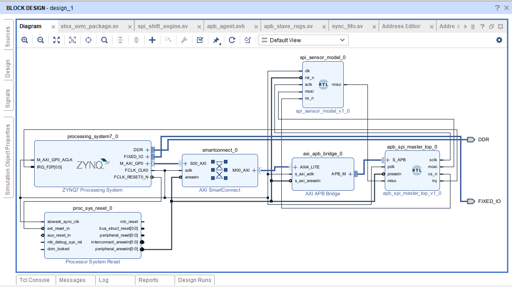
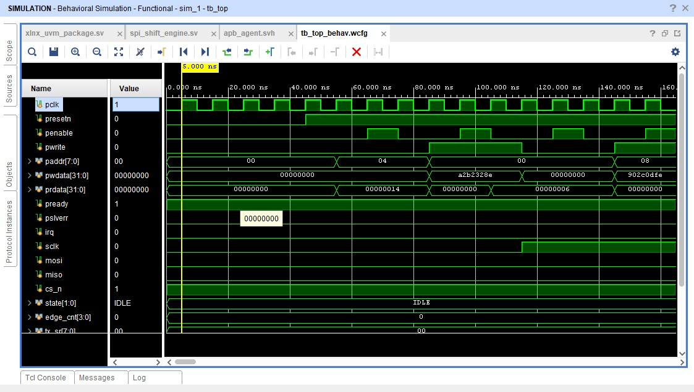
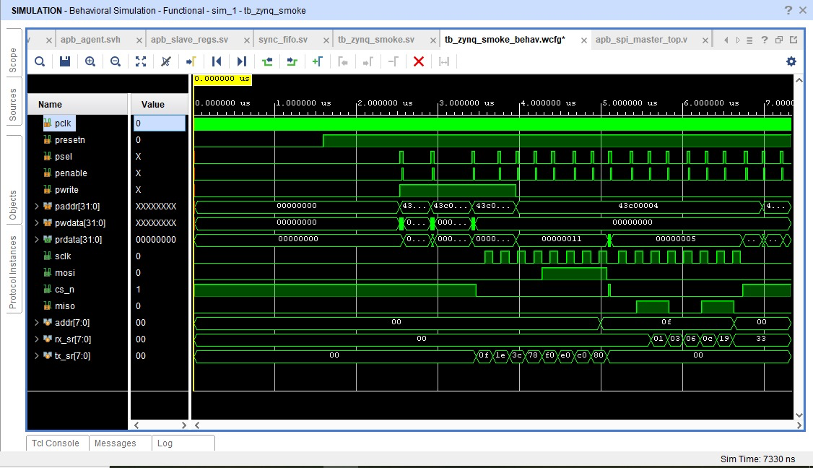
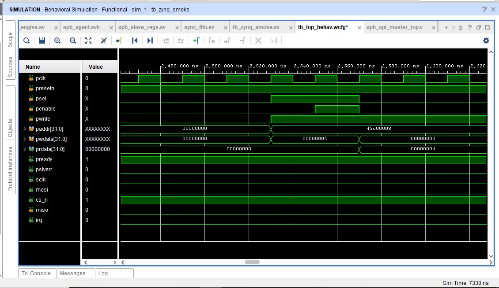
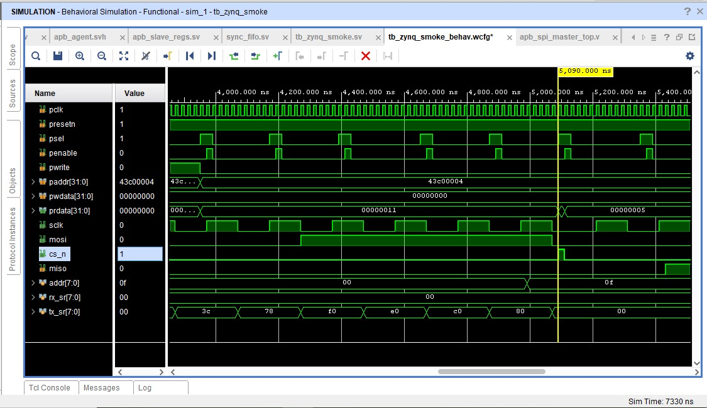
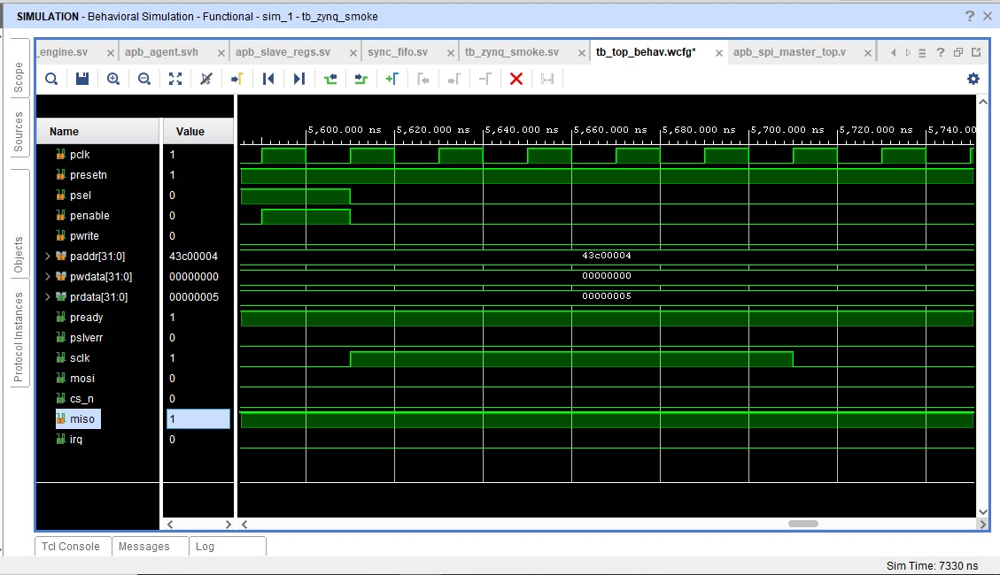

# APB SPI Master IP

SPI master with an APB register interface, written in SystemVerilog. It is verified with a UVM testbench and tested inside a Zynq-7000 system in Vivado 2025.2 (simulation).

| Check | Result |
|---|---|
| UVM testbench | 398 checks, 0 errors, 100 % functional coverage |
| Zynq-7000 system test | PASS: WHO_AM_I = 0x33 |
| Synthesis (xc7z020) | 98 LUTs, 66 flip-flops |

## Features

- APB slave with 6 registers, no wait states
- SPI modes 0 to 3, 8-bit frames, MSB first
- 8-byte TX FIFO and 8-byte RX FIFO
- Clock divider: f_SCLK = f_PCLK / (2 × (CLKDIV + 1))
- Interrupt on TX empty or RX data available

## Registers

Base address in the Zynq design: 0x43C0_0000

| Offset | Name | Access | Bits |
|---|---|---|---|
| 0x00 | CTRL | R/W | 0 EN, 1 CPOL, 2 CPHA |
| 0x04 | STATUS | R | 0 BUSY, 1 TX_FULL, 2 TX_EMPTY, 3 RX_FULL, 4 RX_EMPTY |
| 0x08 | CLKDIV | R/W | 7:0 divider |
| 0x0C | TXDATA | W | 7:0 byte to send |
| 0x10 | RXDATA | R | 7:0 byte received |
| 0x14 | IRQ_EN | R/W | 0 TX empty, 1 RX available |

## Block Design

The Zynq PS sends AXI transactions to an AXI SmartConnect and an AXI APB Bridge. The bridge drives the APB port of the IP, and the IP talks to a SPI sensor model.



## UVM verification

The testbench checks the IP alone, with two agents, a scoreboard, functional coverage and assertions.

- **APB agent:** plays the processor. The driver generates the APB SETUP and ACCESS phases, the monitor records every transfer.
- **SPI agent:** plays the sensor. The responder answers with random bytes on MISO in the selected SPI mode, the monitor rebuilds the MOSI and MISO bytes.
- **Scoreboard:** every byte written to TXDATA must appear on MOSI, every byte seen on MISO must be read back from RXDATA, and register reads must return the written values. At the end of the test, no byte may be left unchecked.
- **Functional coverage:** the 4 SPI modes crossed with 3 divider ranges (0, 1 to 3, 4 to 255), plus the data values 0x00 and 0xFF.
- **Assertions (7 SVA):** APB protocol rules, CS_n low only when the engine is busy, SCLK at its idle level when a frame starts, no push into a full FIFO and no pop from an empty FIFO.
- **Tests:** register test, interrupt test, random test (all modes with dividers 0, 2 and 6, then 30 random bursts of 1 to 8 bytes), and all_test, which runs the three.

Result of all_test in Vivado XSim:

```text
Functional coverage = 100.0%
398 checks OK, 0 errors -> PASS
UVM_WARNING : 0
UVM_ERROR   : 0
UVM_FATAL   : 0
```

**Start of the UVM test:** reset release, then APB register accesses. STATUS reads 0x14 after reset, CTRL is written with CPOL = 1 and reads back 0x06, then CLKDIV is written. SCLK moves to its new idle level (1) right after the CTRL write.



## Zynq-7000 system test

The Zynq VIP plays the ARM processor. It sets CLKDIV = 4 and CTRL = mode 0, sends 0x0F (WHO_AM_I address) then a dummy 0x00, polls STATUS until the transfer ends and reads two bytes. The sensor model answers 0x33 in the second byte.

**Full test, 0 to 7.3 µs:** register writes, two SPI bytes, STATUS polling, RXDATA reads.



**APB write of CLKDIV:** SETUP phase, then ACCESS phase.



**Between the two bytes:** CS_n goes high for one clock cycle.



**SCLK at 5 MHz:** high for 100 ns with PCLK = 50 MHz and CLKDIV = 4.



## Files

```text
rtl/    IP source code and SPI sensor model
tb/     UVM testbench
bd/     Zynq system test
docs/   images
```

## License

© 2026 Nacereddine Seddouki. All rights reserved. No part of this project may be copied, modified or reused without written permission.
